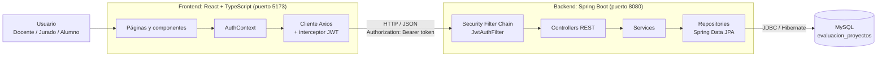
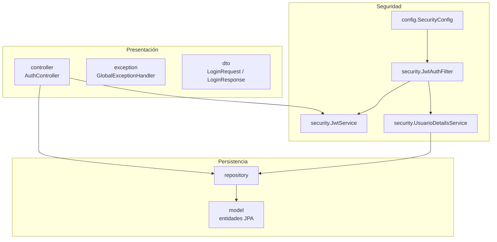
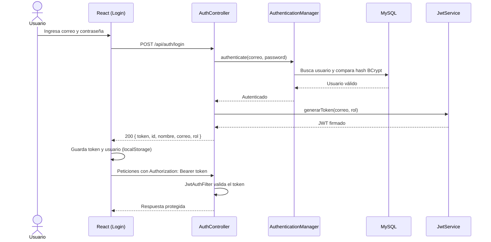
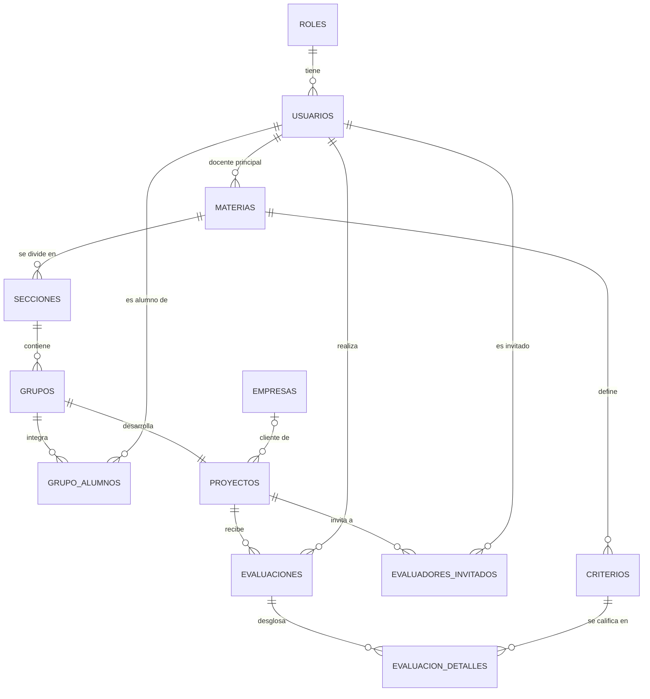

# Sistema Web de Evaluación de Proyectos

Sistema web para gestionar y automatizar la evaluación de proyectos académicos, con **criterios configurables por materia, sección y grupo** y **evaluación colaborativa entre docentes y jurado**.

> **Institución:** ITCA-FEPADE, Centro Regional Santa Ana
> **Carrera:** Técnico en Ingeniería de Desarrollo de Software
> **Módulo:** Utilización de Frameworks · **Ciclo:** 02 · **Año:** 2026
> **Grupo:** _(completar)_

---

## 1. Descripción del proyecto

### Problema
La evaluación de los proyectos de los estudiantes se hace de forma manual: cada docente define sus criterios en hojas de papel o archivos sueltos y calcula la nota final a mano o en hojas de cálculo independientes. Esto produce criterios poco uniformes entre secciones, errores de cálculo, pérdida o duplicidad de información y dificultad para consolidar la nota cuando participan varios evaluadores (docentes invitados o jurado). Tampoco existe un registro centralizado que relacione docentes, jurado, materias, alumnos, empresa y proyecto.

### Solución
Una aplicación web donde el **docente principal** de cada materia define una sola vez los criterios y su ponderación, invita a otros docentes o miembros del jurado a evaluar con esos mismos criterios, y el sistema **calcula la nota final automáticamente**.

### Objetivo general
Desarrollar un sistema web que permita gestionar y automatizar la evaluación de proyectos académicos, mediante criterios configurables y la participación de múltiples evaluadores, para obtener la nota final de cada grupo de forma ágil, transparente y centralizada.

---

## 2. Tecnologías

| Capa | Tecnología |
|---|---|
| Frontend | React + TypeScript, Vite, React Router, Axios |
| Backend | Java, Spring Boot (Spring Web, Spring Data JPA, Spring Security, Validation, Lombok) |
| Autenticación | JWT (JJWT 0.12.6) y contraseñas con BCrypt |
| Base de datos | MySQL |
| Control de versiones | Git y GitHub |
| Gestión ágil | Scrum y Taiga |

---

## 3. Arquitectura

### 3.1 Visión general

El sistema sigue una arquitectura **cliente-servidor** con un frontend desacoplado (SPA) que consume una **API REST** protegida con JWT.



### 3.2 Capas del backend



| Paquete | Responsabilidad |
|---|---|
| `controller` | Endpoints REST. Reciben y responden JSON. |
| `dto` | Objetos de transferencia y validaciones de entrada. |
| `model` | Entidades JPA mapeadas a las tablas. |
| `repository` | Acceso a datos con Spring Data JPA. |
| `security` | Filtro JWT, generación y validación de tokens, carga de usuarios. |
| `config` | Configuración de seguridad, CORS y datos iniciales. |
| `exception` | Manejo centralizado de errores (por ejemplo, credenciales inválidas). |

### 3.3 Flujo de autenticación



**Decisiones de seguridad**

- **Stateless:** no hay sesiones en el servidor; cada petición lleva su JWT.
- **Contraseñas** almacenadas con **BCrypt**, nunca en texto plano.
- **Rutas protegidas:** solo `/api/auth/login` es pública; el resto exige token.
- **CORS** limitado al origen del frontend (`app.cors.origin`).
- **Roles** (`ALUMNO`, `JURADO`, `DOCENTE`) incluidos en el token para autorizar por rol.
- Una petición sin autenticación responde **401**.

### 3.4 Arquitectura del frontend

```
evaluacion-front/src/
├── api/          Cliente Axios con interceptor que adjunta el token
├── context/      AuthContext: estado de sesión (login, logout, usuario)
├── components/   RutaPrivada: protege rutas que requieren sesión
├── pages/        Login y Dashboard
├── App.tsx       Definición de rutas
└── main.tsx      Punto de entrada
```

---

## 4. Modelo de datos



| Tabla | Propósito |
|---|---|
| `roles`, `usuarios` | Usuarios unificados (alumno, jurado, docente) con su rol. |
| `materias`, `secciones` | Materias con su docente principal y sus secciones por ciclo. |
| `grupos`, `grupo_alumnos` | Equipos de alumnos dentro de una sección. |
| `empresas` | Cliente real del proyecto (opcional). |
| `proyectos` | Proyecto de un grupo; controla la publicación de resultados. |
| `criterios` | Criterios de evaluación con su ponderación (%). |
| `evaluadores_invitados` | Docentes o jurado invitados a evaluar un proyecto. |
| `evaluaciones`, `evaluacion_detalles` | Evaluación de cada evaluador (borrador o enviada) y nota por criterio. |

**Cálculo de la nota:** la nota de cada evaluador es la suma de `nota_otorgada × ponderación / 100` de todos los criterios; la **nota final del proyecto** es el promedio de las evaluaciones enviadas.

El script completo de la base de datos está en [`/database/schema.sql`](database/schema.sql).

---

## 5. API REST (avance actual)

| Método | Endpoint | Acceso | Descripción |
|---|---|---|---|
| `POST` | `/api/auth/login` | Público | Inicia sesión y devuelve el JWT. |
| `GET` | `/api/auth/me` | Autenticado | Devuelve los datos del usuario del token. |

**Ejemplo de petición**

```http
POST /api/auth/login
Content-Type: application/json

{
  "correo": "docente@itca.edu.sv",
  "password": "********"
}
```

**Respuesta**

```json
{
  "token": "eyJhbGciOi...",
  "id": 2,
  "nombre": "Docente Principal",
  "email": "docente@itca.edu.sv",
  "rol": "DOCENTE"
}
```

> Los nombres de los campos pueden variar según la versión final de los DTO.

### Módulos disponibles actualmente

Además de autenticación, el backend incluye controladores y servicios para:

- Usuarios, roles y alumnos.
- Materias, secciones, subsecciones, matrículas, asignaciones y grupos.
- Empresas y proyectos.
- Criterios y esquemas de evaluación.
- Invitaciones de docentes y jurados.
- Evaluaciones, autoevaluaciones y resultados.
- Notas finales, evaluación pública, estadísticas y reportes.
- Recuperación de contraseña y envío opcional de correo.

Las rutas principales disponibles en el frontend son:

| Ruta | Descripción | Roles |
|---|---|---|
| `/gestion/:modulo` | Gestión de entidades académicas y catálogos | `ADMIN`, `DOCENTE` |
| `/modalidades` | Configuración de esquemas de evaluación | `ADMIN`, `DOCENTE` |
| `/evaluacion/:modo` | Evaluación según modalidad | `ADMIN`, `DOCENTE`, `JURADO` |
| `/evaluacion-publica` | Configuración de evaluación pública | `ADMIN`, `DOCENTE` |
| `/reportes` | Reportes y estadísticas | `ADMIN`, `DOCENTE`, `JURADO` |
| `/notas` | Consulta y gestión de notas finales | `ADMIN`, `DOCENTE` |
| `/mi-proyecto` | Proyecto del alumno | `ALUMNO` |
| `/mis-criterios` | Criterios aplicables al alumno | `ALUMNO` |
| `/autoevaluacion` | Autoevaluación | `ALUMNO` |
| `/mi-nota` | Nota del alumno | `ALUMNO` |
| `/publico/:codigo` | Consulta pública de un proyecto | Público |

La configuración de permisos de la API está centralizada en `SecurityConfig`. Las rutas públicas incluyen login, recuperación de contraseña y recursos públicos; el resto requiere autenticación JWT.

---

## 6. Estructura del repositorio

```
.
├── src/main/java/com/example/Sistema_de_Evaluacion_de_Proyectos/
│   ├── config/          SecurityConfig, DataSeeder
│   ├── controller/      AuthController
│   ├── dto/             LoginRequest, LoginResponse
│   ├── exception/       GlobalExceptionHandler
│   ├── model/           Usuario, Rol
│   ├── repository/      UsuarioRepository
│   └── security/        JwtService, JwtAuthFilter, UsuarioDetailsService
├── src/main/resources/application.properties
├── pom.xml
├── evaluacion-front/    Aplicación React + TypeScript
└── README.md
```

La estructura completa del backend también contiene los paquetes `service`, `config`, `security` y los repositorios y entidades correspondientes a cada módulo funcional.

---

## 7. Instalación y ejecución

### Requisitos

- JDK 17 o superior
- Maven (o el wrapper `mvnw` incluido)
- Node.js 18 o superior
- MySQL/MariaDB o PostgreSQL
- Docker Desktop (opcional)

### 1. Base de datos

MySQL/MariaDB es el motor principal. PostgreSQL está disponible como alternativa secundaria. La selección es manual: configura `DB_TYPE` en la ejecución del backend. El backend no cambia de motor si la base seleccionada está detenida; en ese caso el arranque falla.

Para MySQL/MariaDB, inicia el servicio predeterminado:

```powershell
docker compose up -d db
```

Para PostgreSQL, inicia el servicio opcional:

```powershell
docker compose --profile postgres up -d postgres
```

Los dos motores mantienen bases y volúmenes independientes. Cambiar `DB_TYPE` no copia ni sincroniza datos entre ellos.

### 2. Backend

En IntelliJ, abre **Run → Edit Configurations…**, selecciona la configuración del backend y define `DB_TYPE` en **Environment variables**. Usa `DB_TYPE=mysql` para la base principal o `DB_TYPE=postgres` para la secundaria. Los usuarios, contraseñas y URL locales tienen valores de desarrollo definidos en `application.properties`; se pueden sustituir mediante `MYSQL_URL`, `MYSQL_USER`, `MYSQL_PASSWORD`, `POSTGRES_URL`, `POSTGRES_USER` y `POSTGRES_PASSWORD`.

Después de cambiar el valor, detén y vuelve a iniciar el backend. Comprueba en la consola el mensaje `Motor de base de datos seleccionado manualmente` y el motor al que se conectó.

Para generar la clave JWT en PowerShell:

```powershell
$bytes = New-Object byte[] 32
[System.Security.Cryptography.RandomNumberGenerator]::Create().GetBytes($bytes)
[Convert]::ToBase64String($bytes)
```

Para enviar los códigos de recuperación por Gmail, configura SMTP antes de iniciar el backend. Gmail usa `smtp.gmail.com`, puerto `587` y STARTTLS:

```powershell
$env:MAIL_ENABLED = "true"
$env:MAIL_HOST = "smtp.gmail.com"
$env:MAIL_PORT = "587"
$env:MAIL_USERNAME = "tu_correo@gmail.com"
$env:MAIL_PASSWORD = "tu contraseña de aplicación"
$env:MAIL_FROM = $env:MAIL_USERNAME
.\mvnw.cmd spring-boot:run
```

Las variables SMTP también se pueden agregar en **Environment variables** de la configuración de IntelliJ. No compartas ni subas esa configuración con credenciales.

Ejecuta el backend:

```powershell
.\mvnw.cmd spring-boot:run
```

Queda disponible en `http://localhost:8080`.

### 3. Frontend

```powershell
Set-Location .\evaluacion-front
npm install
npm run dev
```

Queda disponible en `http://localhost:5173`.

---

## 8. Alcance del avance y hoja de ruta

### Implementado en este avance

- [x] Inicio de sesión con JWT y contraseñas cifradas con BCrypt
- [x] Control de acceso por roles
- [x] Rutas protegidas en el frontend y manejo de sesión
- [x] Modelo de base de datos del sistema
- [x] Datos iniciales de prueba (`DataInitializer`)
- [x] Gestión de materias, secciones, subsecciones, matrículas y grupos
- [x] Gestión de empresas y proyectos
- [x] Criterios configurables por materia y por grupo
- [x] Esquemas de evaluación, autoevaluación y evaluación pública
- [x] Invitación de docentes y jurados
- [x] Evaluaciones en borrador o enviadas
- [x] Cálculo de notas finales y consulta de resultados
- [x] Reportes, estadísticas y exportación a Excel/PDF
- [x] Recuperación de contraseña con soporte opcional de correo

### Próximos sprints

- [ ] Pruebas de calidad y validación con docentes y estudiantes

### Base de datos con Docker

Para levantar la base principal MySQL/MariaDB:

```powershell
docker compose up -d db
```

El servicio utiliza MariaDB 10.11 y publica el puerto `3307`. Para levantar PostgreSQL 16 en el puerto `5432`, usa el perfil opcional:

```powershell
docker compose --profile postgres up -d postgres
```

Configura `DB_TYPE` en IntelliJ para elegir a cuál motor conectará el backend y reinícialo después de cada cambio. Puedes detener el contenedor anterior desde Docker Desktop. Hibernate crea o actualiza las tablas de cada motor al iniciar; los datos de ambos contenedores se conservan en volúmenes separados.

### Comandos de validación

Backend:

```powershell
.\mvnw.cmd test
```

Frontend:

```powershell
Set-Location .\evaluacion-front
npm run lint
npm run build
```

---

## 9. Metodología

El proyecto se desarrolla con **Scrum**: sprints cortos, un backlog priorizado de historias de usuario, estimación por puntos de historia, y reuniones de planificación, diaria, revisión y retrospectiva. El tablero del proyecto está en Taiga: _(agregar enlace)_.

---

## 10. Equipo

| Carnet | Integrante |
|---|---|
| 024325 | Yesica Elizabeth Anaya Castaneda |
| 020225 | Fernando Daniel Castaneda Herrera |
| 026125 | Fatima Nahomy Miranda Urbano |
| 030225 | Dennis Alexander Serrano Loarca |
| 039725 | Sayra Hermione Valladares Peña |
| 041225 | Bryan Alexander Vanegas Rivas |

**Docente:** _(completar)_

---

## 11. Limitaciones

- Desarrollo dentro del ciclo 02 de 2026, con disponibilidad limitada del equipo.
- Uso de herramientas gratuitas o de licencia educativa, sin servidor de producción propio.
- El sistema se limita a la evaluación de proyectos, sin integrarse con otros sistemas académicos institucionales.
- Validación con datos de prueba y colaboración voluntaria de docentes y estudiantes.
